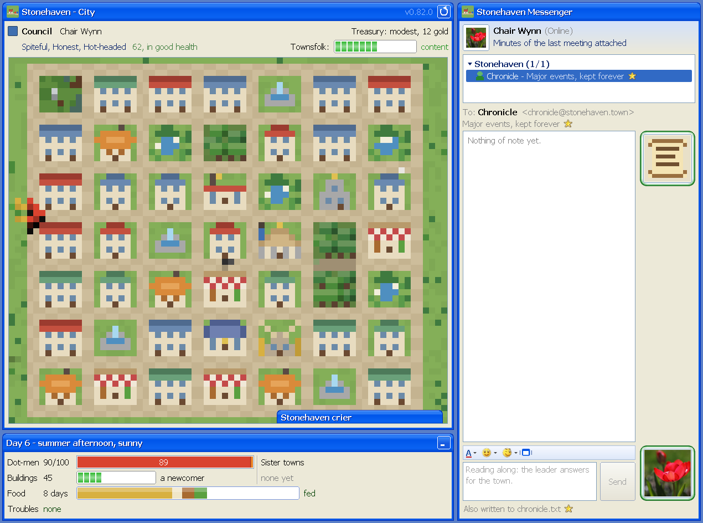

# Dotburg

A little pixel town that grows by itself while the window is open, from one hamlet house to a city. You watch from
the leader's seat but pull no levers: the townsfolk live, marry, fall ill, quarrel, riot and vote on their own.
Each town has its own landscape and land (groves, ponds, rocks, marsh), a rule that can change hands, sister towns,
and a Messenger where the leader's friends, rivals and the chronicle talk.

## Install
There is no release download. Dotburg runs on the owner's PC only.

1. Install the **.NET 10** runtime if it is not there yet.
2. Double-click **Build Dotburg.bat** in the `dotburg-app` folder and wait for **Done**.
3. Start Dotburg from the **Dotburg** shortcut on the Desktop or in the Start menu.

Updates: close Dotburg, then run **Build Dotburg.bat** again. The town carries on from where it was.

Uninstall: delete the `Dotburg Town` folder next to `dotburg-app`, the two **Dotburg** shortcuts, and
`%APPDATA%\Dotburg` (the saved town and `chronicle.txt`).

## Usage
The town grows only while the window is open and picks up exactly where it was left. Rest the mouse on a building,
a piece of land or any bar for details. The Messenger on the right shows the chronicle and whoever the leader talks
to; the button at the top right starts a new region (the old town is backed up first).

| Key | Action |
|---|---|
| H | Hide or show the panels |
| M | Mute or unmute the sounds |
| F11 | Full screen on or off |
| Esc | Close the new-region question |

## Known limits
- Windows only, and built from source on this PC; there is no installer or signed exe.
- No growth while closed, on purpose: new things happen while you watch.
- Land arrived in 0.82: towns saved before that keep none until a new region starts.
- No levers on purpose. The leader cannot be steered; you only watch and read.
